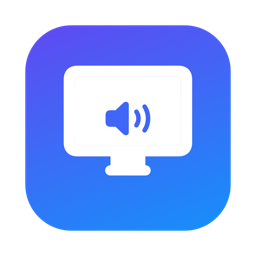
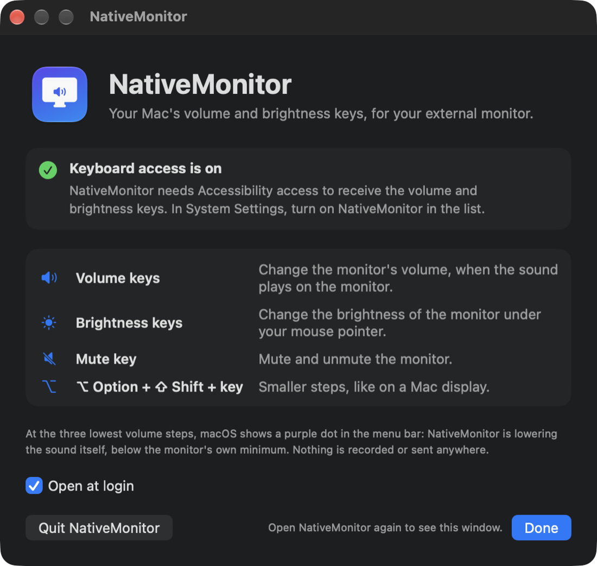

<p align="center"></p>

<h1 align="center">NativeMonitor</h1>

<p align="center">Your Mac's volume and brightness keys, for your external monitor.</p>

---

macOS can only change the volume and brightness of Apple displays. Plug in a Dell, LG, Samsung, Philips, ASUS or BenQ
monitor over HDMI or DisplayPort and the volume slider is greyed out, and the brightness keys do nothing.

NativeMonitor makes those keys work on your monitor, with an on-screen indicator like the built-in one. It has no
menu bar icon and no settings to set up.

<p align="center"></p>

## Features

- **Volume keys** change your monitor's speaker volume when the sound plays on the monitor.
- **Smooth volume, down to silence.** Many monitors are already loud at their lowest volume step. NativeMonitor
  adds three quieter steps below it.
- **Brightness keys** change the brightness of the monitor under your mouse pointer. Your Mac's own display keeps
  working as usual.
- **Mute key**, and **⌥ Option + ⇧ Shift + key** for smaller steps.
- **Several monitors** are supported.
- **Lightweight:** about 15 MB of memory and 0% CPU when idle. It has no audio driver and no kernel extension.

## Requirements

| | |
|---|---|
| Mac | Apple silicon (M1 or later). Intel Macs are not supported. |
| macOS | 14.4 Sonoma or later |
| Monitor | Supports **DDC/CI**. Most do; on some it's an option in the monitor's own menu. Volume needs built-in speakers. |
| Cable | USB-C, Thunderbolt or DisplayPort. ⚠️ The built-in HDMI port of M1 Macs and the base M2 Mac mini doesn't pass DDC through. |

## Install

1. Download **NativeMonitor.zip** from the [latest release](../../releases/latest) and unzip it.
2. Move **NativeMonitor.app** to your **Applications** folder.
3. Open it. NativeMonitor isn't signed with a paid Apple Developer ID, so the first time macOS says it can't verify
   the developer:
   - Open **System Settings → Privacy & Security**, scroll down, and click **Open Anyway** next to NativeMonitor.
   - Or, in Terminal: `xattr -dr com.apple.quarantine /Applications/NativeMonitor.app`
4. In the welcome window, click **Open Settings** and turn on **NativeMonitor** under **Accessibility**. This lets it
   receive the volume and brightness keys.

That's it. NativeMonitor opens at login. To see the window again, open the app again from Finder, Launchpad or
Spotlight.

## Permissions

| Permission | Why |
|---|---|
| **Accessibility** | To receive the volume and brightness keys. NativeMonitor only reacts to these keys. |
| **System Audio Recording** | Asked the first time you go below your monitor's lowest volume step. To make the sound quieter than the monitor can, NativeMonitor lowers your Mac's sound itself before sending it to the monitor. Nothing is recorded, stored or sent anywhere. |

While the sound is lowered this way (only at the three lowest volume steps), macOS shows a **purple dot** in the menu
bar. That's macOS telling you an app is processing system audio. It goes away as soon as you turn the volume up.

## How it works

- **Brightness and volume** are sent to the monitor over [DDC/CI](https://en.wikipedia.org/wiki/Display_Data_Channel),
  the standard way computers control monitor settings.
- **Below the monitor's lowest volume step**, NativeMonitor uses a Core Audio process tap (macOS 14.4+) to lower the
  sound in software. There's no virtual audio device: if NativeMonitor quits, macOS plays sound normally again.
- If your monitor doesn't accept volume over DDC/CI, NativeMonitor sets the whole volume range in software.
- The volume keys only act when the sound plays on a monitor. On your Mac's speakers or AirPods, macOS handles them as
  usual.

## Troubleshooting

**Nothing happens when I press the keys.**
Check that NativeMonitor is turned on in **System Settings → Privacy & Security → Accessibility**. If it's already on,
remove it with **−**, then open NativeMonitor again.

**Brightness or volume keys don't change my monitor.**
Turn on **DDC/CI** in your monitor's menu. If your Mac's built-in HDMI port is used, try a USB-C or DisplayPort cable.
To see what NativeMonitor detects, run:

```sh
/Applications/NativeMonitor.app/Contents/MacOS/NativeMonitor --monitors
```

**The volume ramp feels uneven on my monitor.**
Monitors don't all respond the same way to volume steps. You can reshape the ramp, then restart NativeMonitor.
Values above 1 make the low steps finer, values below 1 make them coarser:

```sh
defaults write io.github.nmani97.NativeMonitor ddcCurve -float 1.5
```

**Logs** are in `~/Library/Logs/NativeMonitor.log`.

## Uninstall

1. Open NativeMonitor and click **Quit NativeMonitor**.
2. Move **NativeMonitor.app** to the Trash.
3. Optionally, remove its settings: `defaults delete io.github.nmani97.NativeMonitor`

## Build from source

You need Xcode or the Xcode Command Line Tools.

```sh
./scripts/build.sh          # builds build/NativeMonitor.app and dist/NativeMonitor.zip, runs the self-test
```

To keep macOS permissions across rebuilds, sign with a code-signing identity from your keychain:
`SIGN_ID="My Identity" ./scripts/build.sh`.

The whole app is one file: [`Sources/main.swift`](Sources/main.swift).

## License

[MIT](LICENSE)
